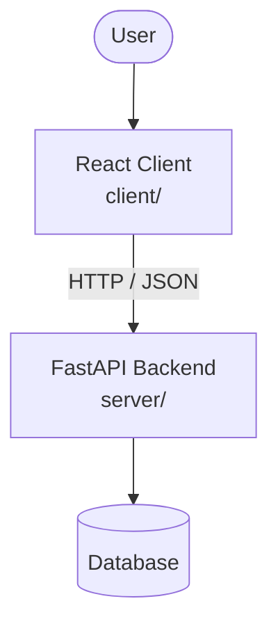

# Architecture

_Auto-generated by the SDLC Assistant from the generated codebase and the approved Feature Spec (latest: SCRUM-485). Regenerated on each push._

## System Diagram

## Tech Stack
- Not specified

## Backend Modules (server/)
- server/__init__.py
- server/config.py
- server/database.py
- server/main.py
- server/models/__init__.py
- server/models/currency.py
- server/models/product.py
- server/models/user.py
- server/routers/__init__.py
- server/routers/auth.py
- server/routers/currencies.py
- server/routers/health.py
- server/routers/products.py
- server/schemas/__init__.py
- server/schemas/currency.py
- server/schemas/product.py
- server/schemas/user.py
- server/services/__init__.py
- server/services/auth_service.py
- server/services/currency_service.py
- server/services/pricing_service.py
- server/tests/__init__.py
- server/tests/conftest.py
- server/tests/test_auth.py
- server/tests/test_conversion_fallback.py
- server/tests/test_currencies.py
- server/tests/test_products_pricing.py

## Frontend Modules (client/)
- (no client/ files found yet)

## API Endpoints
- None

## Data Model
- None
